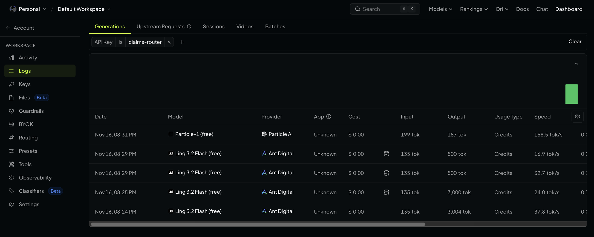

# Build Notes

## CLM-0001: validated RoutingDecision

Model: `particle-ai/particle-1:free` (provider: Particle AI). Only `claim_text` was sent; no label column reached the prompt.

```json
{
  "specialists": [
    "billing",
    "shipping",
    "stock"
  ],
  "reason": "The card was charged twice for the whole order, so billing is needed for the duplicate charge. Only one box arrived with the stroller and the car seat was not delivered, so shipping is needed for the missing/partial delivery. The seller page says the car seat is out of stock, so stock is needed for the unavailable item.",
  "confidence": 1.0
}
```

## Specialists vs label

| Specialist | Predicted | `label_specialists` |
|------------|-----------|---------------------|
| billing    | yes       | yes                 |
| shipping   | yes       | yes                 |
| stock      | yes       | yes                 |

Mismatches: none. The prediction matches `billing|shipping|stock` exactly.

## Does the reason hold up?

Holds up fully, and also addresses other issues (car seat out of stock).

## Screenshot

OpenRouter activity for the `claims-router` key: the earlier Ling 3.2 Flash runs that hit the output cap, then the Particle-1 run that validated.



## Router prompt (key part)

System prompt in `router.py`:

```
You route customer refund claims to specialists.
billing: charges, double charges, payment amounts.
shipping: missing, late, damaged or partial deliveries.
stock: out-of-stock or unavailable items.
Pick every specialist the claim needs.
The reason must cite concrete facts from the claim text.
```

The user message is the claim text only. The reply is constrained with `response_format` set to `json_schema` with `strict: true` using `RoutingDecision`'s schema, plus `provider.require_parameters: true` and `max_tokens=500`.

## What I checked or changed

Added require_parameters and max_tokens after a free model ignored strict JSON schema, then switched models until CLM-0001 validated; checked that only claim_text reached the prompt and no label column leaked into it.
